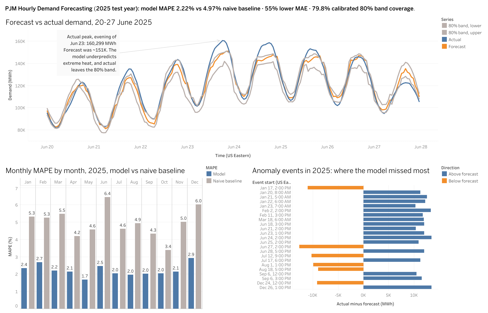
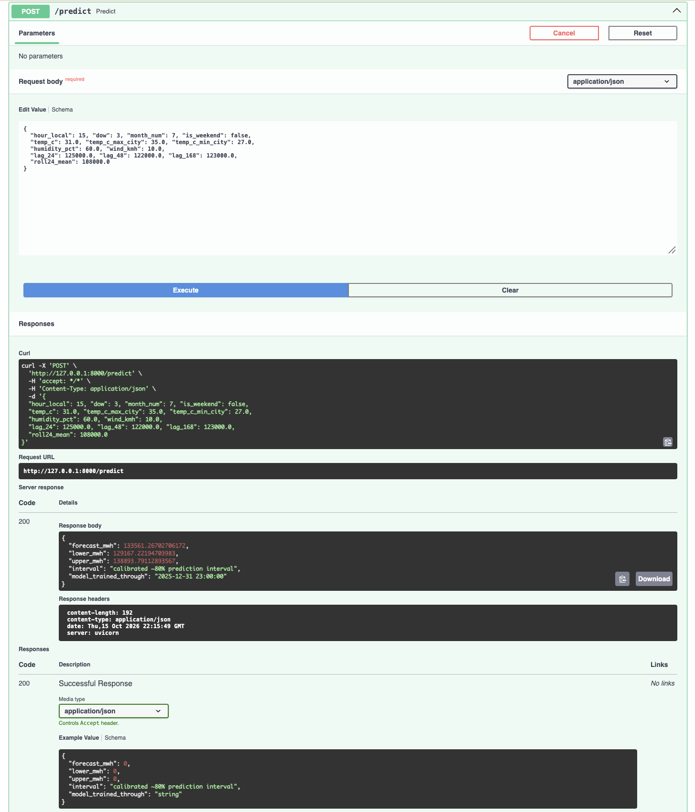
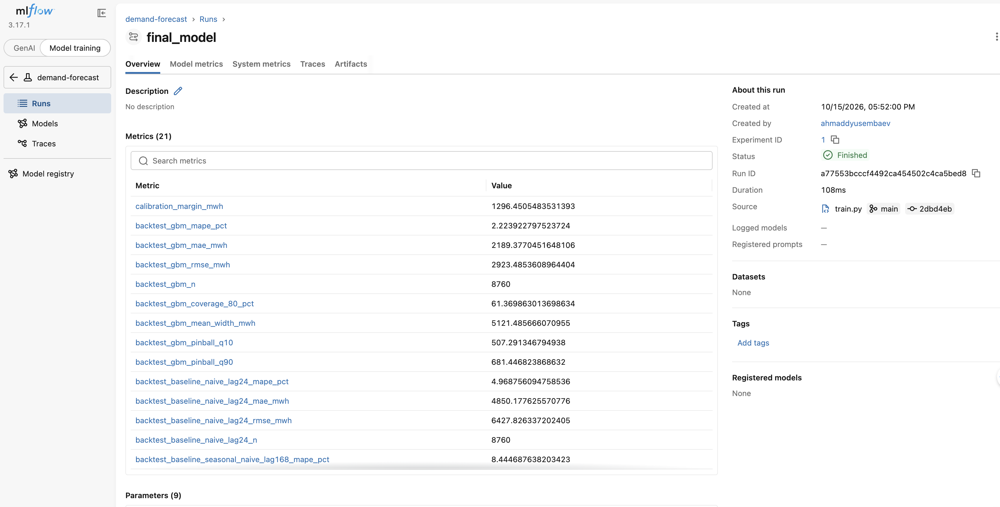
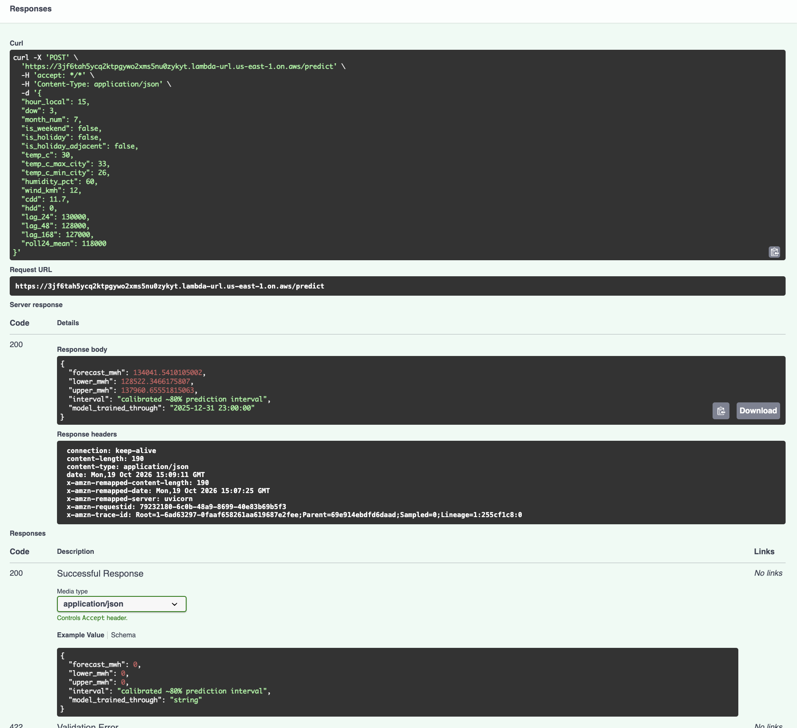

# Hourly Electricity Demand Forecasting Platform

End-to-end forecasting project for the PJM grid: public demand and weather data, SQL feature tables, a gradient-boosted model with calibrated prediction intervals, anomaly detection, explainability, experiment tracking, a Dockerized API and a public Tableau dashboard.

**Live dashboard:** [PJM demand forecasting on Tableau Public](https://public.tableau.com/app/profile/akhmad.dyussembayev/viz/PJMdemandforecasting_17923745734520/Dashboard)

**Live API (AWS Lambda):** https://3jf6tah5ycq2ktpgywo2xms5nu0zykyt.lambda-url.us-east-1.on.aws/docs (interactive docs; the first request after idle takes a few seconds)



## Results

Backtest: 12 monthly rolling-origin folds over 2025 (8,760 test hours). Each fold trains only on data before its test month. Imputed hours are excluded from scoring.

| Metric (2025 test year) | Naive baseline (same hour yesterday) | Model |
|---|---|---|
| MAPE | 4.97% | **2.22%** |
| MAE | 4,850 MWh | **2,189 MWh** (about 55% lower) |
| 80% interval coverage | n/a | 61.4% raw, **79.8% after calibration** |

- Adding holiday features moved MAPE from 2.34% to 2.22%.
- Raw quantile bands were too narrow. A conformal adjustment, calibrated on the three prior months, brings overall coverage to 79.8%.
- The model beats the baseline in every month (see the monthly chart on the dashboard).
- Anomaly detection (robust z-score on forecast errors, |z| > 4) flags 75 hours, grouped into 23 events. The large misses come in runs of consecutive days (for example 20-23 Jan and 21-25 Jun), which look like extended cold and heat spells, plus a few isolated days where demand came in below forecast.

## Architecture

```
EIA Open Data API (hourly PJM demand)     Open-Meteo archive (5 cities)
              \                                  /
               +--> Python ingest --> raw Parquet
                              |
                              v
              DuckDB SQL: clean hourly grid, DST gap imputation,
              lags (24/48/168 h), rolling mean, degree hours, holidays
                              |
                              v
        HistGradientBoosting: point forecast + 10th/90th percentile
        rolling-origin backtest --> conformal calibration of the band
                    |                          |
                    v                          v
      MLflow tracking (SQLite)     Anomaly events + SHAP / permutation importance
                    |
                    v
        Model bundle --> FastAPI --> Docker image
                    |                     |
                    v                     v
   Tableau Public dashboard       Amazon ECR --> AWS Lambda (Function URL)
        (CSV exports)
```

## Repository layout

| Path | What it does |
|---|---|
| `src/ingest.py` | Pulls demand (EIA) and weather (Open-Meteo) |
| `sql/` | DuckDB transforms: clean demand grid, weather, feature table |
| `src/build_features.py` | Runs the SQL and writes the feature table |
| `src/baseline.py`, `src/model.py` | Naive baseline and gradient-boosted model, with rolling-origin backtest |
| `src/calibrate.py` | Conformal calibration of the 80% band |
| `src/anomaly.py` | Robust-z anomaly flags grouped into events |
| `src/explain.py` | SHAP and permutation importance |
| `src/train.py`, `src/predict.py` | Final model bundle and prediction helpers |
| `src/api.py` | FastAPI service (`/health`, `/predict`) |
| `src/export_dashboard.py` | Tidy CSVs for Tableau |
| `docs/` | Data notes, result tables, figures |
| `tests/` | pytest suite |

## Data

- **Demand:** EIA Open Data API v2, hourly PJM demand, 2023-2025.
- **Weather:** Open-Meteo historical archive for Philadelphia, Washington DC, Pittsburgh, Columbus and Chicago, averaged into one regional series.
- Quality checks, the daylight-saving gap handling and the cleaning rules are in [`docs/data_notes.md`](docs/data_notes.md).

## Run it

```bash
python -m venv .venv
source .venv/bin/activate
pip install -r requirements.txt
cp .env.example .env              # add your EIA API key; .env is git-ignored
pytest

python -m src.ingest              # download demand and weather
python -m src.build_features      # SQL feature table
python -m src.baseline            # naive baseline backtest
python -m src.model               # model backtest (logged to MLflow)
python -m src.calibrate           # calibrated 80% band
python -m src.anomaly             # anomaly events
python -m src.explain             # SHAP and permutation importance
python -m src.train               # save the model bundle
python -m src.export_dashboard    # CSVs for Tableau
```

### API

```bash
uvicorn src.api:app --reload      # http://127.0.0.1:8000/docs for the interactive schema
```

`POST /predict` takes one target hour's features (calendar, temperature, demand lags) and returns a forecast in MWh with a calibrated 80% band. Inputs are validated: lag values must be between 20,000 and 250,000 MWh, and the forecast is clamped to sit inside its own band.



### Docker

```bash
docker build -t demand-forecast .
docker run -p 8000:8000 demand-forecast
```

The image contains only the API and the saved model bundle, with pinned dependencies.



## Deployment (AWS)

The same Docker image runs on AWS Lambda as a container image, behind a public Function URL.

- **Image:** pushed to Amazon ECR (`linux/arm64`).
- **Adapter:** the [AWS Lambda Web Adapter](https://github.com/awslabs/aws-lambda-web-adapter) is added in the Dockerfile, so the FastAPI app runs unchanged.
- **Function:** 1024 MB memory, 30 s timeout, Function URL with no authentication (demo only).
- **Cold start:** the first request after idle takes a few seconds while the container loads the model.

Example request to the live endpoint (a July weekday at 3 PM, 30 C, demand lags near 130,000 MWh) returned a forecast of about 134,000 MWh with a calibrated 80% band of roughly 128,500 to 138,000 MWh:



To redeploy:

```bash
export AWS_REGION=us-east-1
export ACCOUNT_ID=$(aws sts get-caller-identity --query Account --output text)
export REPO=$ACCOUNT_ID.dkr.ecr.$AWS_REGION.amazonaws.com/demand-forecast

aws ecr get-login-password --region $AWS_REGION | docker login --username AWS --password-stdin $ACCOUNT_ID.dkr.ecr.$AWS_REGION.amazonaws.com
docker build --platform linux/arm64 --provenance=false -t ${REPO}:latest .
docker push ${REPO}:latest
```

Then use "Deploy new image" on the Lambda function. Note: in zsh, write `${REPO}:latest` with braces, because `$REPO:latest` is parsed as a lowercase modifier.

## Limitations

- **Observed weather, not forecast weather.** The backtest uses actual temperatures for the target hour. In production the model would receive a weather forecast, so real-world error would be higher. Rerunning with archived forecast inputs is the main next step.
- **Rare holidays.** Holiday features help, but the model is weaker on days with few historical examples.
- **Calibration lag.** The band is calibrated on the three prior months, so coverage falls below the 80% target when conditions change fast (about 66% in June, 72% in November and 68% in December).
- **Extreme heat and cold.** The largest misses are demand spikes during heat or cold spells, such as 23 Jun 2025, where actual demand reached about 160,000 MWh against a forecast near 151,000.
- **Trained range only.** Tree models cannot extrapolate beyond the demand levels they saw, so the API rejects implausible inputs.
- **Source revisions.** EIA demand is reported by the grid operator and can be revised after the fact.
- **Demo-grade deployment.** The Lambda endpoint has no authentication, rate limiting beyond a concurrency cap, or live monitoring. It is a portfolio demo, not a production service.

## Roadmap

- [x] Ingest, SQL features, baseline, backtesting
- [x] Gradient-boosted model, calibrated intervals, holidays
- [x] Anomaly detection, SHAP, MLflow tracking
- [x] FastAPI service and Docker image
- [x] Tableau Public dashboard
- [x] Deployed to AWS Lambda (ECR container image, Function URL)
- [ ] Forecast-weather inputs in the backtest
- [ ] Monitoring (drift and error tracking) and API authentication
